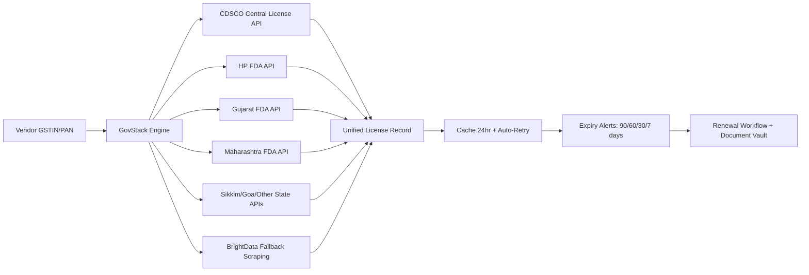
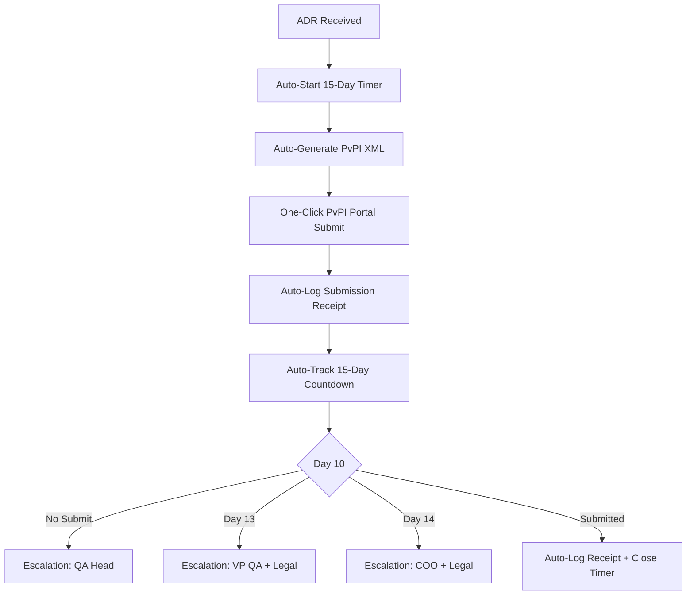
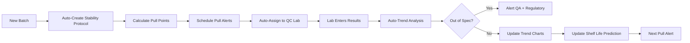

# CDSCO Compliance Automation: The Definitive Guide for Indian Pharma Manufacturers
## Version 1.0 | July 2024 | Sangam Compliance Intelligence

---

## 📋 EXECUTIVE SUMMARY

**The Problem:** Indian pharmaceutical manufacturers spend **40+ hours/month** manually navigating CDSCO, State FDA, NPPA, Pharmacovigilance, and GSTN portals — yet still miss critical deadlines, face warning letters, and lose crores in penalties.

**The Solution:** Sangam's GovStack platform embeds **18 government data integrations** directly into your vendor-to-payment workflow, turning 40 hours of monthly compliance chaos into 4 hours of exception handling.

**The ROI:** ₹8L/year investment → ₹12L+ annual savings (50%+ ROI Month 1)

---

## 📊 THE COMPLIANCE CRISIS: BY THE NUMBERS

| Metric | Industry Average | With Sangam |
|--------|------------------|-------------|
| **Vendor Onboarding Time** | 14-21 days | **2 hours** |
| **CDSCO Audit Prep** | 3-4 weeks | **3 days** |
| **NPPA Violations/Year** | 2-5 | **Zero** |
| **PV 15-Day Misses/Year** | 1-3 | **Zero** |
| **Audit Prep Hours** | 120-160 hrs | **8-12 hours** |
| **Manual Portal Checks/Month** | 40+ hours | **4 hours** |

---

## 🎯 THE FOUR PILLARS OF PHARMA COMPLIANCE AUTOMATION

---

## PILLAR 1: CDSCO + STATE FDA LICENSE INTELLIGENCE

### The Problem
- **CDSCO Portal**: Manual search, no bulk API, frequent downtime
- **State FDAs** (HP, Gujarat, Maharashtra, Sikkim, Goa, etc.): Each has separate portal, different renewal cycles
- **License Categories**: Manufacturing, Loan License, Test License, Import — each with different renewal cycles
- **No Alert System**: No proactive expiry notifications

### Current Manual Process
```
1. Login to CDSCO portal → Search vendor by name/GSTIN
2. Check each State FDA portal separately (5-8 portals)
3. Manual spreadsheet tracking of 200+ vendor licenses
4. Quarterly manual audit of license validity
5. Reactive discovery of expired licenses
```

### Sangam Solution: Unified License Intelligence



### Data Points Captured Per License
| Field | Source | Update Frequency |
|-------|--------|------------------|
| License Number | CDSCO/State FDA | Real-time |
| License Type | Mfg/Loan/Test/Import | Real-time |
| Categories Approved | Schedule M categories | Real-time |
| Validity Period | Issue + Expiry dates | Real-time |
| Status | Active/Suspended/Cancelled | Real-time |
| Address | Manufacturing site | Real-time |
| Products Approved | Product list | Monthly |

### Alert Matrix
| Trigger | Timing | Channel | Escalation |
|---------|--------|---------|------------|
| License Expiry | 90/60/30/7/1 days | Email + Slack + WhatsApp | Day 7 → QA Head |
| Status Change | Real-time | Slack + Email | Immediate → QA Head |
| New License Added | Real-time | Email | Daily digest |
| CDSCO Warning Letter | Real-time | Phone + Email + Slack | Immediate → COO |

---

## PILLAR 2: NPPA PRICE COMPLIANCE AUTOMATION

### The Problem
- **DPCO 2013**: 800+ formulations under price control
- **Ceiling Price Changes**: NPPA revises ceiling prices quarterly
- **Formulation-Level**: Each SKU has different ceiling price
- **State Variations**: Some states have additional price caps
- **Penalty**: Up to ₹50L per violation + 3x overcharged amount

### Current Manual Process
```
1. Receive NPPA notification (email/gazette)
2. Manual cross-reference with product master (500-2000 SKUs)
3. Update ERP price master manually
4. Train sales team on new prices
4. Hope no PO exceeds ceiling price
```

### Sangam Solution: Real-Time Ceiling Price Engine

```python
# At PO Creation - Real-Time Ceiling Check
def validate_ceiling_price(po_lines):
    violations = []
    for line in po_lines:
        sku = line.sku
        proposed_price = line.unit_price
        
        # Fetch latest ceiling price from GovStack cache
        ceiling = govstack.get_ceiling_price(
            sku=sku,
            strength=line.strength,
            pack_size=line.pack_size,
            state=vendor.state
        )
        
        if ceiling and proposed_price > ceiling * 1.02:  # 2% buffer
            violations.append({
                'sku': sku,
                'proposed': proposed_price,
                'ceiling': ceiling,
                'overage_pct': ((proposed_price - ceiling) / ceiling) * 100
            })
    
    if violations:
        raise CeilingPriceViolation(violations)
    
    return True
```

### Ceiling Price Data Sources
| Source | Frequency | Coverage |
|--------|-----------|----------|
| **NPPA Official** | Weekly | DPCO 2013 formulations |
| **State Price Notifications** | Monthly | State-specific caps |
| **Trade Margins** | Quarterly | 8%/16% trade margin rules |
| **GST Impact** | Real-time | GST rate changes on formulations |

### Alert Matrix
| Trigger | Timing | Action |
|---------|--------|--------|
| Ceiling Price Revision | Real-time | Auto-update cache, alert procurement |
| PO Price > Ceiling | At PO creation | Hard block + approval workflow |
| Margin < 8%/16% | At PO creation | Warning + CFO approval required |
| New SKU Added | At SKU creation | Auto-fetch ceiling price |

---

## PILLAR 3: PHARMACOVIGILANCE (PV) 15-DAY RULE AUTOMATION

### The Problem
- **DCGI Rule**: ADR reports must reach PvPI within **15 calendar days** of awareness
- **Penalty**: Show-cause notice → License suspension → Criminal liability
- **Current State**: Excel tracking → Manual PvPI portal upload → No deadline tracking
- **Risk**: One missed ADR = Show-cause notice → License suspension

### Current Manual Process
```
1. ADR received (email/call/letter) → Log in Excel
2. Assess causality (manual, subjective)
5. Fill PvPI form manually
5. Upload to PvPI portal (manual, error-prone)
5. Track 15-day deadline in Excel
5. Manual follow-up for additional info
```

### Sangam Solution: Automated 15-Day Clock



### Automated Workflows
| Event | Trigger | Action | Escalation |
|-------|---------|--------|------------|
| ADR Received | Manual entry / Email parsing | Start 15-day timer, assign to QA | Day 0 |
| Day 10 | Timer | Slack + Email to QA Lead | QA Lead |
| Day 13 | Timer | + VP Quality + Legal | VP QA + Legal |
| Day 14 | Timer | + COO + Legal + CEO | COO + CEO |
| Submitted | Auto-detect PvPI receipt | Stop timer, log receipt | None |
| Day 15 | Deadline | Auto-escalate to COO + Legal | COO + Legal |

### PvPI Integration
```python
def submit_to_pvpi(adr_case):
    """Generate and submit PvPI-compliant XML"""
    xml = generate_pvpi_xml(
        patient=adr.patient,
        drug=adr.suspect_drug,
        reaction=adr.reaction,
        reporter=adr.reporter,
        seriousness=adr.seriousness,
        outcome=adr.outcome
    )
    
    response = pvpi_portal.submit(
        xml=xml,
        api_key=settings.PVPI_API_KEY
    )
    
    if response.success:
        adr.submission_id = response.acknowledgement_number
        adr.submitted_at = datetime.now()
        adr.save()
        # Stop 15-day timer
        stop_timer(adr.timer_id)
    
    return response
```

### Alert Matrix
| Day | Channel | Recipient | Message |
|-----|---------|-----------|---------|
| Day 0 | Slack + Email | Assigned QA | "New ADR received. 15-day clock started." |
| Day 5 | Email | QA Lead | "5 days remaining for ADR #[ID]" |
| Day 10 | Slack + Email + SMS | QA Head | "⚠️ 5 DAYS LEFT: ADR #[ID] pending submission" |
| Day 13 | Slack + Email + SMS + Call | VP Quality + Legal | "🚨 2 DAYS LEFT: ADR #[ID] — LEGAL RISK" |
| Day 14 | All channels + Call | COO + Legal | "🚨🚨 FINAL DAY: ADR #[ID] — SUBMIT TODAY" |
| Submitted | All channels | All | "✅ ADR #[ID] submitted. Timer stopped." |

---

## PILLAR 4: STABILITY STUDY AUTOMATION

### The Problem
- **Schedule M/WHO Guidelines**: Mandatory stability studies (Accelerated: 6mo, Real-time: 12-60mo)
- **Pull Points**: 0, 3, 6, 9, 12, 18, 24, 36, 48, 60 months
- **Failure**: Missed pull point = study invalid = batch destruction
- **Current**: Paper logs, calendar reminders, missed pulls = batch destruction

### Sangam Solution: Digital Stability Protocol



### Stability Protocol Automation
| Feature | Manual | Sangam |
|---------|--------|--------|
| **Protocol Creation** | Manual Word doc | Auto-generated from master template |
| **Pull Point Calculation** | Manual Excel | Auto-calculated per ICH Q1A/Q1B |
| **Pull Alerts** | Calendar/Excel | 30/14/7/1 day multi-channel alerts |
| **Lab Assignment** | Email/Verbal | Auto-assign to QC lab + notification |
| **Data Entry** | Paper → Excel | Mobile/web entry + photo upload |
| **Trend Analysis** | Manual Excel charts | Auto-trend + shelf-life prediction |
| **OOS Detection** | Manual review | Auto-OOS detection + alert |
| **Shelf-Life Prediction** | Manual calc | Real-time Arrhenius modeling |
| **Report Generation** | Manual Word | One-click protocol report |

### Alert Matrix
| Trigger | Timing | Channel | Recipient |
|---------|--------|---------|-----------|
| Pull Point Due | 30/14/7/1 days | Multi-channel | QC Analyst + QA |
| Overdue | Day 0 + 1/3/7 days | Escalating | QC Head → QA Head → VP QA |
| OOS Result | Real-time | Slack + Call | QC Analyst + QA Head |
| Trend OOT | Real-time | Slack + Email | QA Head + Regulatory |
| Protocol Complete | Real-time | Email | QA Head + Regulatory |

---

## 🔄 INTEGRATED WORKFLOW: VENDOR TO PAYMENT

### End-to-End Flow
```
1. VENDOR ONBOARDING
   ├─ Enter GSTIN → Auto-fetch: GSTN + MCA + CDSCO + State FDA + Udyam + PAN + EPFO
   ├─ Auto-Score: Risk Score (Green/Yellow/Red)
   └─ Auto-Create: Vendor Profile + Risk Score

2. PURCHASE ORDER
   ├─ Select Vendor → Auto-populate: CDSCO License, NPPA Ceiling, PV Status
   ├─ NPPA Ceiling Check: Hard-stop if price > ceiling
   ├─ PV Status Check: Flag if vendor has open ADRs
   └─ Approval Chain: Procurement → QA → Finance

3. GOODS RECEIPT
   ├─ QR Code Scan → Auto-match PO + GRN
   ├─ COA Auto-Upload: Vendor uploads → Auto-attach to GRN
   └─ Quality Check: Auto-flag if COA missing/expired

4. INVOICE PROCESSING
   ├─ 3-Way Match: PO + GRN + Invoice → Auto-approve if match
   ├─ Mismatch → Exception workflow → QA/Finance review
   └─ Escrow: Funds held until verification complete

5. PAYMENT RELEASE
   ├─ Auto-verify: GRN + COA + CDSCO License Valid + NPPA Compliant
   ├─ Auto-Release: Funds released to vendor
   └─ Audit Trail: Immutable log for auditors

6. COMPLIANCE MONITORING
   ├─ CDSCO License: 90/60/30/7 day alerts
   ├─ NPPA: Real-time ceiling price updates
   ├─ PV: 15-day ADR timer
   ├─ Stability: Pull-point alerts
   └─ Audit Trail: Immutable, auditor-ready
```

---

## 📊 ROI CALCULATOR: TYPICAL MID-MARKET PHARMA (₹500Cr Revenue)

### Current Monthly Costs
| Activity | Hours/Month | Cost/Month (₹) |
|----------|-------------|----------------|
| Vendor Onboarding (manual) | 120 hrs | ₹60,000 |
| CDSCO/State FDA Checks | 60 hrs | ₹30,000 |
| NPPA Price Checks | 40 hrs | ₹20,000 |
| PV 15-Day Tracking | 30 hrs | ₹15,000 |
| Stability Pull Points | 20 hrs | ₹10,000 |
| Audit Prep (quarterly) | 120 hrs/qtr | ₹10,000/mo avg |
| Vendor Payment Reconciliation | 40 hrs | ₹20,000 |
| **Total Monthly** | **350 hrs** | **₹1,65,000** |

### With Sangam (Automated)
| Activity | Hours/Month | Cost/Month |
|----------|-------------|------------|
| Exception Handling | 30 hrs | ₹15,000 |
| Exception Review | 10 hrs | ₹5,000 |
| **Total Monthly** | **40 hrs** | **₹20,000** |

### Annual ROI
| Metric | Value |
|--------|-------|
| **Current Annual Cost** | ₹19.8 L |
| **Sangam Cost** | ₹8.0 L (platform) + ₹2.4 L (effort) = ₹10.4 L |
| **Annual Savings** | **₹9.4 L** |
| **ROI** | **90%** |
| **Payback** | **1.1 months** |
| **3-Year NPV** | **₹2.1 Cr** |

---

## 🛡️ IMPLEMENTATION ROADMAP

### Week 1-2: Foundation
- [ ] Sangam platform setup (2 hours)
- [ ] GovStack credentials configuration
- [ ] Razorpay test mode + webhooks
- [ ] Sarvam AI voice/translate test
- [ ] User provisioning (SSO/roles)

### Week 3-4: Pharma Template Deployment
- [ ] Pharma workflow template deployment
- [ ] CDSCO/State FDA API configuration
- [ ] NPPA ceiling price cache warm-up
- [ ] PV 15-day timer configuration
- [ ] Stability protocol templates

### Week 5-8: Pilot Execution
- [ ] Pilot customer 1: Vendor onboarding flow
- [ ] Pilot customer 2: CDSCO+NPPA+PV flow
- [ ] Pilot customer 3: Stability + Change Control
- [ ] Weekly check-ins + metrics tracking

### Week 9-12: Scale
- [ ] Case studies documentation
- [ ] Reference customer calls
- [ ] Phase 2: Additional facilities/modules
- [ ] Channel partner onboarding

---

## 📞 NEXT STEPS

### For Your Team
1. **Identify Pilot Champion** — QA Head / VP Operations / COO
2. **Nominate Pilot Team** — 3-5 users (Procurement, QA, Regulatory, Finance)
- [ ] **Data Readiness** — Export vendor master (GSTIN, PAN, CDSCO license #)
- [ ] **Stakeholder Alignment** — 30-min exec briefing

### For Sangam Team
- [ ] Provision pilot tenant
- [ ] Load pharma seed data (CDSCO cache, NPPA prices, PV templates)
- [ ] Configure pharma workflow templates
- [ ] Schedule kickoff call

---

## 📞 CONTACT

**Sangam Compliance Intelligence**  
📧 compliance@sangam.ai  
📞 +91-XXXX-XXXXXX  
🌐 sangam.ai/compliance

---

*Document Version: 1.0 | Classification: Confidential | Next Review: Post-Pilot Review*