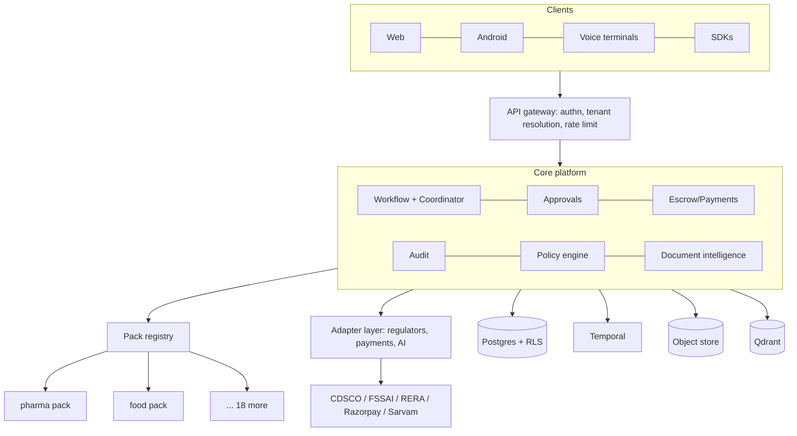

# Architecture: one core, twenty vertical packs

Date: 2026-11-07. Companion to [`MARKET_RESEARCH_20_VERTICALS.md`](../strategy/MARKET_RESEARCH_20_VERTICALS.md). "20" here means 20 industries on one platform, not 20x traffic. These are design hypotheses and have not been load-tested.

## 1. The core idea

Do not fork the product per industry. Keep one core (workflows, approvals, escrow, audit, actors, voice) and add each industry as a **pack**: a versioned bundle of data and small plug-ins. Industry knowledge lives in packs; the core never learns what a "CDSCO licence" is.

## 2. What a pack contains

A pack is a directory with a manifest, shipped and versioned like a library:

| Part | Example for pharma | Notes |
|---|---|---|
| Workflow templates | Vendor qualification, batch release, licence renewal | Declarative data, not Python |
| Document schemas and extractors | CDSCO licence, COA, GMP certificate | Schema, vision prompt, confidence threshold, gold test documents |
| Condition vocabulary | `delivery_verified`, `coa_attached` | The names usable in `safe_eval` conditions |
| Approval matrices | QA head + regulatory head for X | Roles and strategies per step |
| Escrow rules | Release on verified handoff + COA | Uses the core escrow engine |
| Regulator adapters | CDSCO portal or API client | Each ships a fixture mode and contract tests |
| Voice lexicon | Domain terms, hotwords, read-back phrases per language | Limited by TTS language coverage |
| Compliance calendar | Licence renewals, filing cadences | Drives reminders |
| Reports | Audit-ready export | |

Today the repo has only generic templates (`app/templates/prebuilt.py`: procurement, finance, HR) and no pack concept. Pharma logic is spread through vendor, document-intelligence and payment code.

## 3. The decisions that matter

**Tenancy.** Every business table gets a `tenant_id`, enforced by Postgres row-level security, not by remembering a `WHERE`. In the models I read (Approval, Payment, Escrow, Invoice, Workflow, Handoff) I saw no tenant column; I did not read every model. Identity becomes tenant-scoped (email unique per tenant, not globally). Documents are stored under per-tenant prefixes and keys.

**One central policy layer.** The code review's biggest root cause was that "who may do this to that" was missing and scattered; fixing it per endpoint (as `payment_access.py` now does for payments) does not scale to 20 packs. Move to a single policy engine (Cedar or OPA style) with pack-supplied role matrices. Every endpoint asks it one question.

**Pack data without 20x migrations.** Core tables stay stable. Pack-specific fields go in JSONB columns validated against the pack's JSON Schema (the models already have `extra_attributes`). Pack-specific tables are the exception, not the default.

**Deployment cells.** Start with one pooled multi-tenant cell. Add dedicated single-tenant cells, region-pinned, for buyers who require it (defense, some pharma). A cell is a complete stack; a failure or a noisy tenant is contained to one cell.

**Adapters behind one interface.** The repo already has the right pattern: Sarvam and Razorpay clients return canned responses in fixture mode through identical code. Make that a contract for every regulator adapter: live implementation, fixture implementation, and contract tests that both must pass. Government portals without APIs will be the least reliable part; wrap them with retries, circuit breakers and a manual-fallback task.

**AI quality is a release gate.** Each pack ships gold documents and expected extractions. A pack release is blocked if extraction accuracy drops. Low-confidence results go to a human (`CONFIDENCE_REVIEW_THRESHOLD` already exists). Meter AI cost per tenant and per pack.

**Validated releases for regulated buyers.** Pack versions are immutable, with release notes and a change-control record. Pharma and device buyers will ask for a validation package; build the paperwork into the release process from the start.

**Compliance by construction.** DPDP: consent records, retention limits and deletion for voice recordings, by May 2027. Keep the audit log append-only. Store money as `Numeric(14,2)`, not `Float` (the current models use `Float`; a migration is needed).

## 4. Build in stages; do not build the cell architecture first

| Stage | Verticals | What to build | What to resist |
|---|---|---|---|
| 0 | 1 (pharma) | Fix the money path. Add `tenant_id` + RLS. Extract pharma logic into a first-class pack folder. | Packs as a plug-in marketplace |
| 1 | 2-6 | Pack manifest + loader. Declarative templates. Central policy engine. Adapter contract + fixtures. Per-tenant Temporal namespaces. | Dedicated cells |
| 2 | 7-20 | Pack registry with versions, eval-gated releases, external pack authors, dedicated cells, per-tenant metering, Redis-backed limits. | Custom code in the core for one customer |

The test of the design is Stage 1: if medical devices and food can be added mostly as data (a pack folder), the architecture works. If they need core changes, fix the pack interface before adding more.

## 5. What breaks first in the current code

| Problem today | Why it blocks scaling |
|---|---|
| No tenant column (in the models read) | Cannot sell to two customers safely |
| Authorization checked per endpoint | Each new pack re-opens the same hole |
| Templates hardcoded in Python | Every vertical needs a code release |
| `Float` money | Rounding errors at volume; compliance risk |
| In-memory rate limiter (per process) | Does not work with more than one API instance |
| Global `settings` | No per-tenant configuration |
| Global `Actor` email uniqueness | A person at two customers cannot exist |
| Single fixture-mode flag | Fine now; each adapter needs its own |
| Two firmware trees (`firmware/` and `sangam_voice_agent/`) | Two device codebases to certify |

## 6. Risks

- **Pack sprawl:** 20 packs drifting into 20 forks. The reuse column in the market doc is the guardrail; if a pack is under ~50% reuse, treat it as a separate bet.
- **Domain knowledge, not code, is the bottleneck.** Budget a named domain expert per pack.
- **Regulator portals change without notice.** Adapter maintenance is a permanent cost.
- **Over-building.** The honest question at each stage is whether a paying customer needs the next layer.

## 7. Decisions needed from you

1. Pooled multi-tenant first, or dedicated cells from day one for your first customers?
2. Policy engine: adopt Cedar/OPA, or a small in-house rules layer?
3. Keep which firmware tree, `firmware/` (Arduino) or `sangam_voice_agent/` (ESP-IDF)?
4. Are packs authored only by your team, or by partners later? This decides how strict the pack SDK must be.
