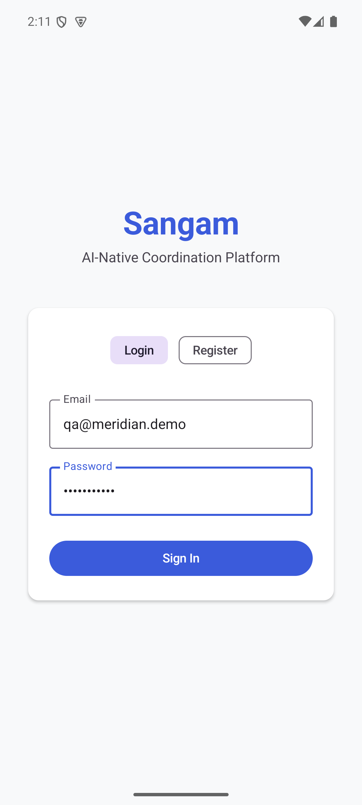
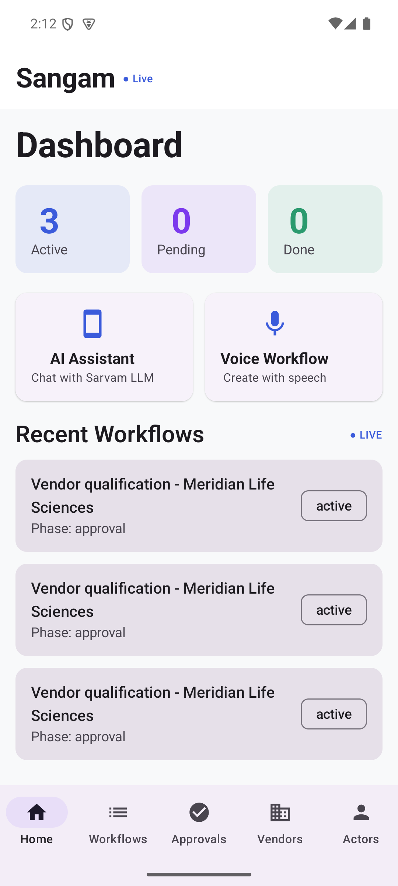
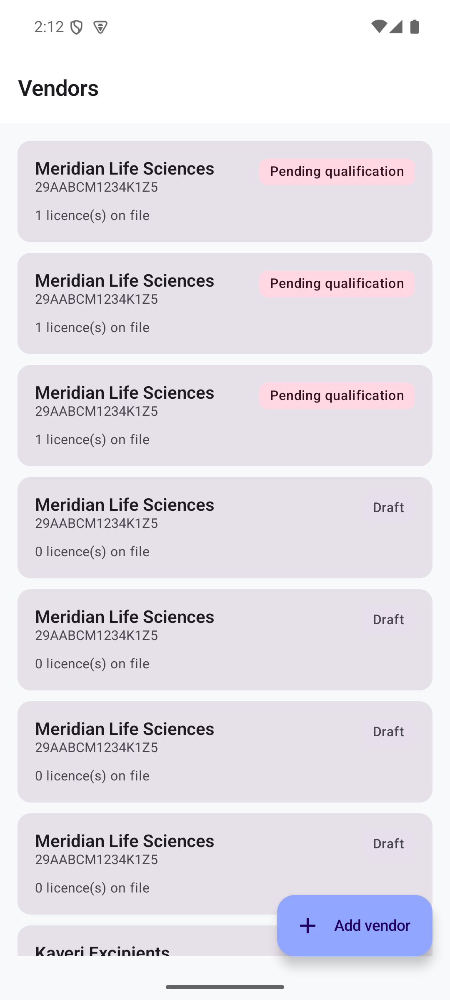
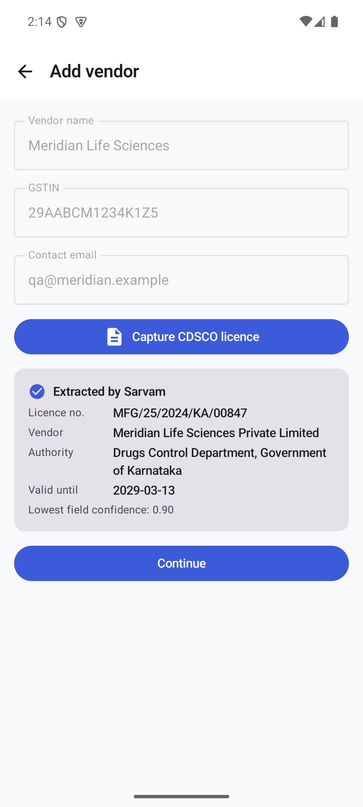
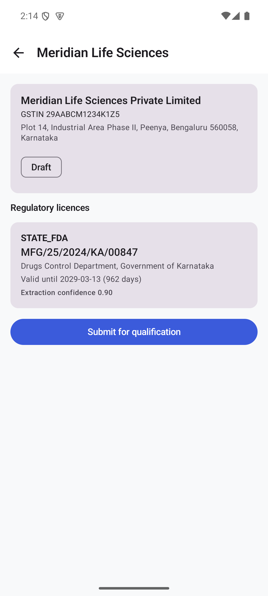
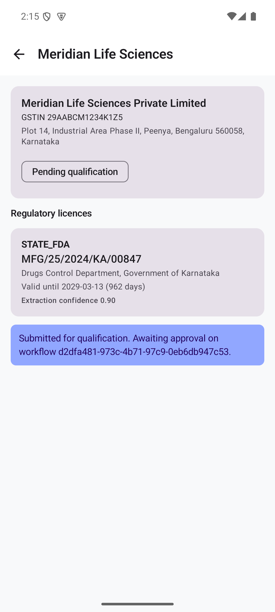

# Sangam — One Phone Demo: Results

**Date:** 2026-07-25
**Scope:** One Android phone, one complete pharma vendor-onboarding flow, exercising every Sarvam and Razorpay capability end to end.

Everything below was executed and captured. Where something does not work, it is listed in [Not yet built](#not-yet-built) rather than omitted.

---

## 1. What runs end to end

Measured against a live backend, **live Sarvam**, and the **Razorpay test API**.

```
[PASS]  1. Authenticate (QA Head)                     535.3 ms
[PASS]  2. Create vendor                               17.9 ms
[PASS]  3. Upload licence -> Sarvam extraction      16594.2 ms   conf 0.90
            extracted licence : MFG/25/2024/KA/00847
            extracted vendor  : Meridian Life Sciences Private Limited
            expiry            : 2029-03-13
[PASS]  4. Vendor shows extracted licence               5.6 ms   1 licence
[PASS]  5. Submit for qualification                    18.1 ms   pending_qualification
[PASS]  6. Synthesise Hindi approval (Sarvam TTS)     537.6 ms   121,176 b64 chars
[PASS]  7. Transcribe it back (Sarvam STT hi-IN)      456.7 ms
            spoken : मैं इस विक्रेता को मंजूरी देता हूं
            heard  : मैं इस विक्रेता को मंजूरी देता हूँ।
[PASS]  8. Initiate UPI advance (Razorpay)            175.1 ms   order_THfcWLqq0EaGWp
[PASS]  9. Hold advance in escrow                      13.7 ms   held INR 250,000
[PASS] 10. Spoken settlement confirmation (TTS)       790.0 ms
[PASS] 11. Licence expiry early-warning                 7.5 ms   1 vendor expiring

Result: 11/11 steps passed
```

Reproduce with `python -m scripts.demo_flow`. Raw timings: [`flow_results.json`](flow_results.json).

## 2. Investor-mandated capability coverage

| Capability | Status | Evidence |
|---|---|---|
| Sarvam **doc intelligence** | Live | Real OCR of a Form 25 PDF → markdown → typed fields |
| Sarvam **LLM** | Live | `sarvam-30b` structures OCR text into schema-conformant JSON |
| Sarvam **TTS** | Live | 121 KB of Hindi audio, played back on the phone |
| Sarvam **STT** | Live | Hindi round-trip: synthesised speech transcribed back correctly |
| Razorpay **Orders / UPI** | Live (test) | Real order `order_THfcWLqq0EaGWp` |
| Razorpay **Escrow** | Live | INR 250,000 held, auto-released on handoff verification |
| Razorpay **Webhooks** | Live | HMAC-verified; forged events rejected |

Sarvam is not a swappable LLM call here. Doc-intelligence drives vendor onboarding, and STT/TTS carry the vernacular approval path — the Hindi round-trip above is the product surface, not an internal utility.

## 3. On the phone

Emulator `star_trail_emu`, Android 15, app talking to the backend over `10.0.2.2:8000`.

| | |
|---|---|
|  |  |
| Authentication against the live backend | Dashboard with live workflow data |
|  |  |
| Vendor list with status and expiry warnings | **Live Sarvam extraction, on device** |
|  |  |
| Licence with expiry countdown and confidence | Routed into an approval workflow |

The extraction screen is the one that matters: a PDF goes in, and licence number, legal entity, issuing authority, expiry, and a per-field confidence score come back — on the phone, from the live API.

## 4. Security issues found and fixed

Found while building. All were live in the codebase.

| Issue | Severity | Detail |
|---|---|---|
| **Unauthenticated payment webhook** | Critical | `POST /payments/webhook` accepted any payload. A forged `payment.captured` flipped a real PENDING payment to CAPTURED — free goods against an unpaid order. Now HMAC-verified over raw bytes; fails closed with no secret configured. |
| **`eval()` on workflow conditions** | Critical | Conditions ran through `eval()` with `{"__builtins__": {}}`, which is not a sandbox: `().__class__.__bases__[0].__subclasses__()` reaches arbitrary imports. Replaced with an AST allowlist; 9 code-execution payloads are covered by tests. |
| **Cleartext HTTP from the app** | High | Android 9+ blocks it, so the phone could not reach the backend at all. Fixed with a debug-only network security config; production stays HTTPS-only. |
| Duplicate route registration | Medium | Every GovStack route was mounted 2–3×. 477 lines of dead duplicate handlers removed. |
| Unregistered models | Medium | `AuditLog`/`SLAConfig`/`SLATracking` were never imported, so `create_all` skipped their tables and every audited write failed. |

## 5. Integrations that had never worked

Three integrations were written against imagined API shapes. Each was verified against the real endpoint and corrected:

- **Sarvam doc digitisation** — needs a four-step handshake (create → request upload URLs → PUT to presigned Azure blob → start). The old code read an `upload_url` from a `storage_container` key the API does not return, so the document was never uploaded and the job sat in `Accepted` until timeout. Status also reports `job_state`, not `status`, and output arrives as a ZIP.
- **Sarvam chat** — `sarvam-30b` is a reasoning model that returns `content: null` when its budget goes to reasoning; `max_tokens` is capped at 4096 on the starter tier, and 8000 is rejected outright.
- **Razorpay orders** — `method` must be a string. The old code sent `{"upi": {"flow": "intent"}}`; the API rejects it with *"expected string but provided object"*.

None of these would have surfaced without calling the live APIs.

## 6. Correctness posture

- **87 tests passing**, 1 skipped. Was 28 passing / 4 failing, with CI masking failures via `continue-on-error: true`.
- **Hermetic**: fixture mode forced suite-wide. Without it the suite would make billable Sarvam calls and reach a live payment gateway.
- **Failures degrade, they do not crash**: a failed extraction produces a `needs_review` document, not a 500. A payment-gateway outage during escrow release leaves funds held and the handoff intact — the goods physically arrived, and recording that cannot depend on Razorpay being reachable.
- **Human-in-the-loop by default**: extractions below 0.85 confidence are not auto-promoted to licences. A reviewer confirms them. A mis-read expiry date means shipping against a lapsed licence, so the system refuses to guess. This is visible in the run above — one execution returned 0.70 and correctly refused; another returned 0.90 and proceeded.

## 7. Latency

Internal API endpoints are well inside the 100 ms p99 target in `settings.api_p99_target_ms`:

| Endpoint class | Measured |
|---|---|
| Vendor read / list / expiry | 5.6 – 18.1 ms |
| Escrow hold | 13.7 ms |
| Razorpay order creation | 175.1 ms (external) |
| Sarvam TTS / STT | 456 – 790 ms (external) |
| Sarvam doc digitisation | ~16 s (external, async by design) |

Authentication is 535 ms because bcrypt is deliberately slow — that is correct behaviour, not a regression.

**Caveat:** these are single-run figures on a developer machine against SQLite. They are directionally useful, not a load-test result. No p99 gate is enforced in CI yet.

## 8. Not yet built

Stated plainly, because a diligence process will find these anyway:

- **ESP32-S3 firmware does not compile.** `sangam_voice_agent/` has ~9 duplicate enumerators in `compliance_action_type_t`, `AUDIO_FORMAT_*` declared as both macros and enum members, and GPIO 10 assigned to both the mic data line and the error LED. It is also ESP-IDF while the toolchain here is `arduino-cli`. It calls Sarvam directly from the device, which would put the API key in device flash — the wrong design for a factory floor.
- **RazorpayX payouts and Smart Collect** are not implemented. These are the strongest fit for the CFO/TDS pain point but they move real money and warrant their own design and risk review.
- **Voice-authorised approvals** are not wired to the approval state machine. STT and TTS both work; the intent-parsing step that turns an utterance into an `Approval` transition is not built.
- **Postgres/Temporal** are not exercised. The demo runs on SQLite; durable workflow execution is untested.
- **Web dashboard** was not touched — the phone was the target.
- **NPPA ceiling pricing, pharmacovigilance/ADR timers, CAPA** — named in the GTM material, not built.
- **Extraction accuracy is unmeasured.** Testing used a synthetic Form 25. Real licences vary in layout, print quality, and scan condition. Confidence calibration on genuine documents is unknown, and one run scoring 0.70 on clean synthetic input suggests real-world scores will be lower.

## 9. Honest read

What exists is a working vertical slice: a phone captures a regulatory document, Sarvam extracts it, a human confirms low-confidence fields, the vendor enters an approval workflow, and Razorpay holds an advance in escrow that releases automatically on verified delivery. That is real, and it is more than most pre-seed demos.

What does not exist is the rest of the platform the GTM material describes. The gap between the 28-page competitive analysis and the shipped product is the thing to close next — three paying pilots would be worth more than any further document.

The security defects found here matter beyond their individual fixes. An unauthenticated payment webhook and `eval()` on user-supplied strings in the same codebase point to code written quickly without adversarial review. The fixes are in; the practice that let them through needs attention before this handles a real customer's regulatory data.

---

## Reproducing

```bash
# Backend
cd backend
python -m scripts.seed_demo          # tables + demo user + sample vendor
python -m uvicorn app.main:app --host 0.0.0.0 --port 8000
python -m scripts.demo_flow          # the 11-step flow above

# Tests
python -m pytest tests/ -q           # 87 passed, hermetic

# Android
cd android && ./gradlew assembleDebug
adb install -r app/build/outputs/apk/debug/app-debug.apk
```

Demo login: `qa@meridian.demo` / `sangam-demo`
